# Revolutionary Court — Case Study

Celebrity / public-figure **community platform** with ratings, reviews, realtime chat, mobile apps, a Next.js public site, and a Laravel admin for moderation.

> Portfolio case study — **screenshots + architecture + stack**. Application source is private.

---

## Links

| Surface | URL |
|---------|-----|
| Public website | https://revolutionarycourt.org |
| Admin panel | https://admin.revolutionarycourt.org |
| Realtime chat server | https://chat-server.revolutionarycourt.org |
| Android app | https://play.google.com/store/apps/details?id=com.revolutionarycourt.app |
| API base | `https://admin.revolutionarycourt.org/api/v1.0/{locale}/` |

---

## Why this exists

Fans and communities need a focused place to **discover personalities**, join communities, rate/review, and chat — without the noise of a general social network. Ops need tools to curate profiles and moderate reported content at community scope.

---

## Product surfaces

| Surface | Role |
|---------|------|
| **Flutter mobile app** | Primary user experience — auth, discovery, communities, chat, reviews |
| **Next.js website** | Marketing + browser discovery (search, spotlights, profiles, i18n) |
| **Laravel admin + API** | CMS, RBAC, celebrity catalog, reports, settings, REST API for apps |
| **Node Socket.IO chat server** | Realtime messaging + live moderation push to online clients |

---

## Screenshots

### Mobile app (Play Store)

| | | |
|--|--|--|
| Sign in |  | 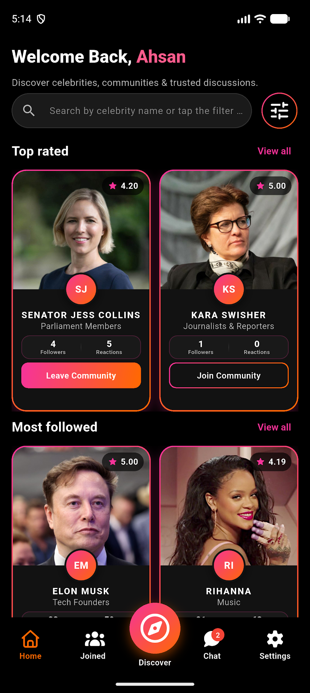 |
| Discovery / communities | 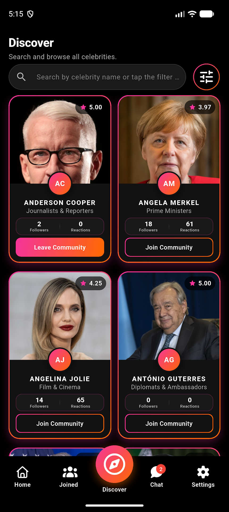 | 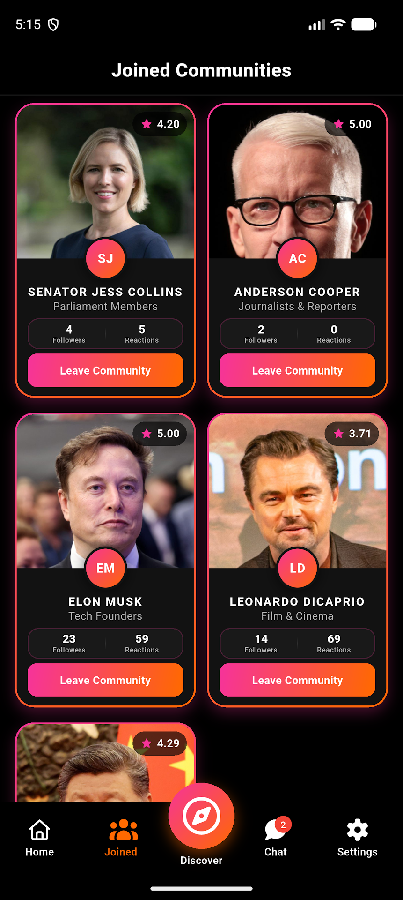 |
| Profile / chat flows |  |  |

### Public website

| | |
|--|--|
| Home | 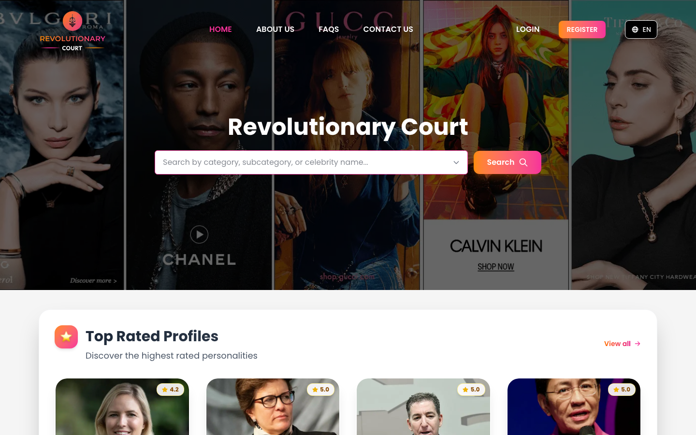 |
| About | 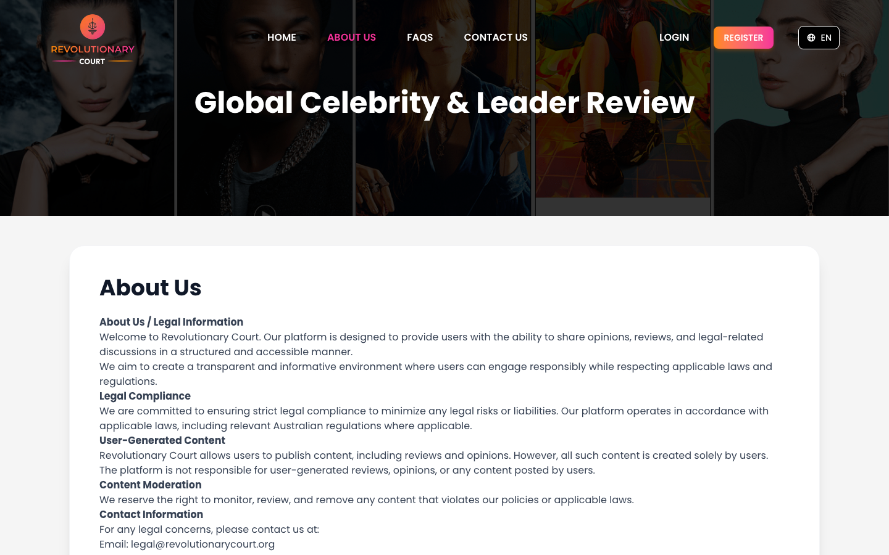 |
| Celebrity profile | 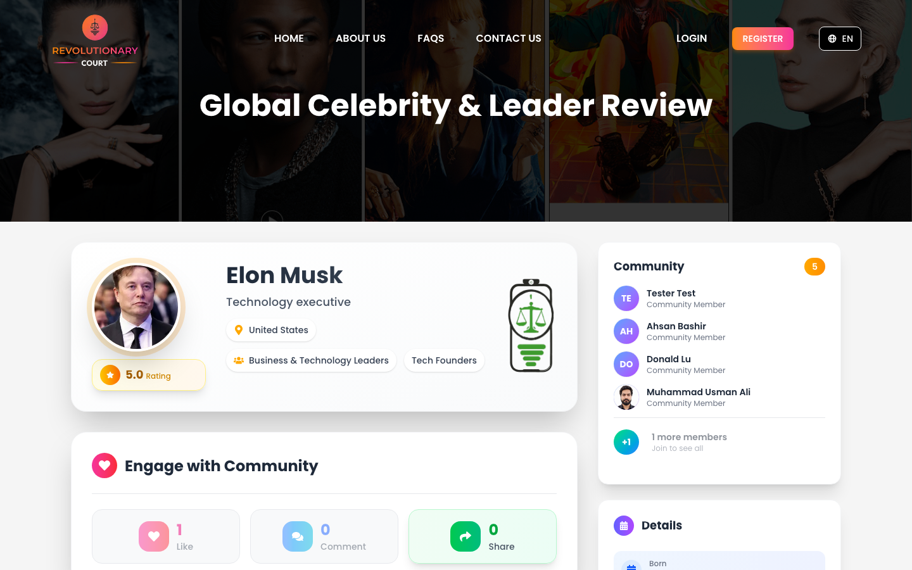 |
| Most followed | 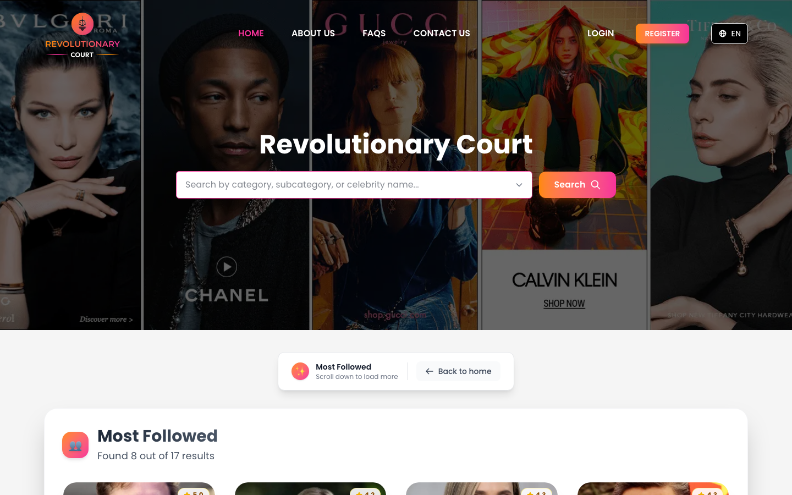 |
| FAQ | 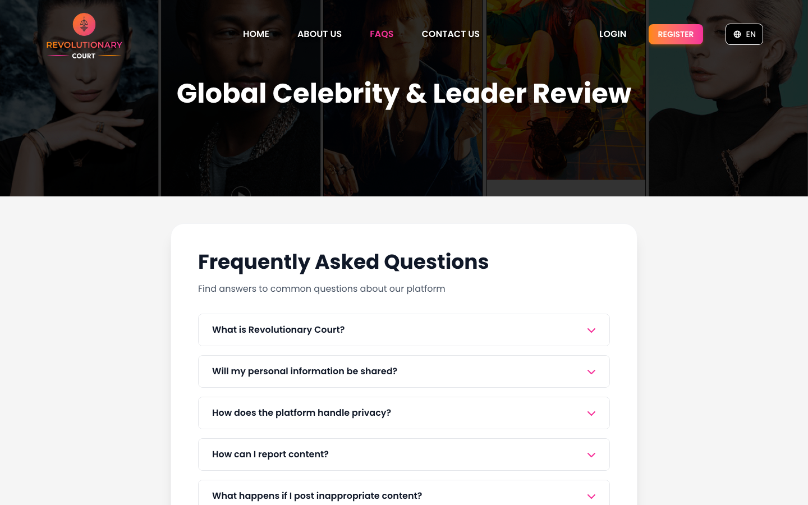 |
| Contact |  |

### Admin

| | |
|--|--|
| Dashboard | 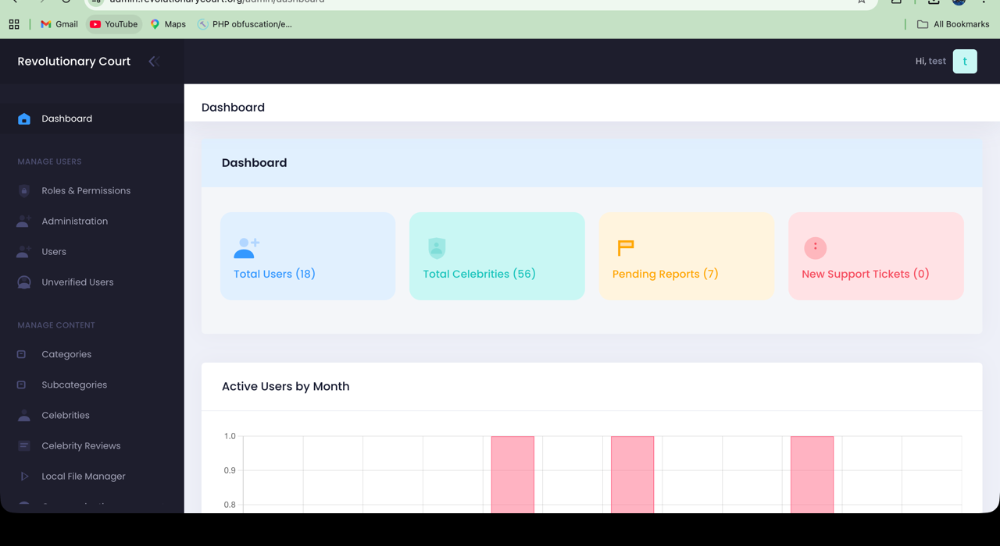 |
| Celebrity profiles | 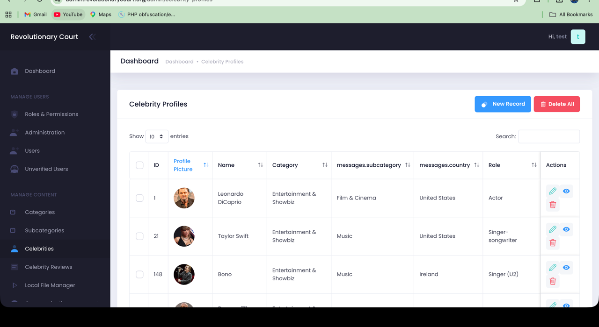 |
| Content reports / community-scoped blocks | 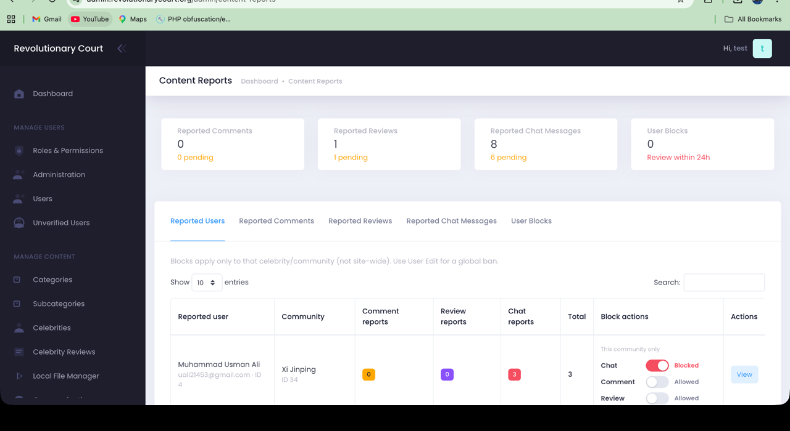 |

---

## Core features

### Discovery & communities
- Celebrity / public-figure profiles with categories & subcategories
- Spotlights: top-rated, most followed, most reacted, most viewed
- Join / leave communities; ratings & reviews
- Search by category, subcategory, or name

### Social & realtime
- In-app / web chat via **Socket.IO**
- Reactions, followers, unread counts
- Live moderation events (`user_moderation_update`) when admin blocks chat/comment/review for a community

### Auth & safety
- Email/password + **Google** + **Apple** Sign-In
- Content reports (comments, reviews, chat messages)
- Admin community-scoped Chat / Comment / Review blocks
- Multi-locale API (`en`, `es`, `ar`, `zh`, …)
- Account privacy / delete-account flows for store compliance

### Admin / CMS
- Roles & permissions (Spatie-style RBAC)
- Users / unverified users
- Categories, celebrities, reviews, file manager
- Content reports queue with pending counts
- CMS pages, social links, authentication settings

---

## Tech stack (actual)

| Layer | Technology |
|-------|------------|
| Mobile | **Flutter** (Android / iOS) — `com.revolutionarycourt.app` |
| Public web | **Next.js** (App Router) + **React** + **Tailwind CSS** + React Toastify |
| Admin UI | **Laravel** Blade + **Metronic** (Bootstrap) admin theme + DataTables |
| Backend API | **Laravel** REST — `/api/v1.0/{locale}/…`, Bearer token auth |
| Realtime | **Node.js** + **Socket.IO** chat server (`chat-server.revolutionarycourt.org`) |
| Auth | Email/password, Google OAuth, Apple identity-token login |
| Infra | nginx on Ubuntu; uploads served from admin host |
| i18n | Locale segment in API + web language switcher (EN+) |

---

## Architecture (high level)

```
Flutter app  ──┐
               ├──► Laravel API  (/api/v1.0/{locale})
Next.js site ──┘         │
                         ├──► MySQL (users, celebrities, reviews, reports, …)
                         └──► Socket.IO chat server  ◄── realtime clients
Admin panel  ──────────► same Laravel app (session + Metronic UI)
```

---

## Notes

- This repository is a **case study** for portfolio review (UI + stack documentation).
- Production source remains private; no application secrets or seed credentials are included here.
