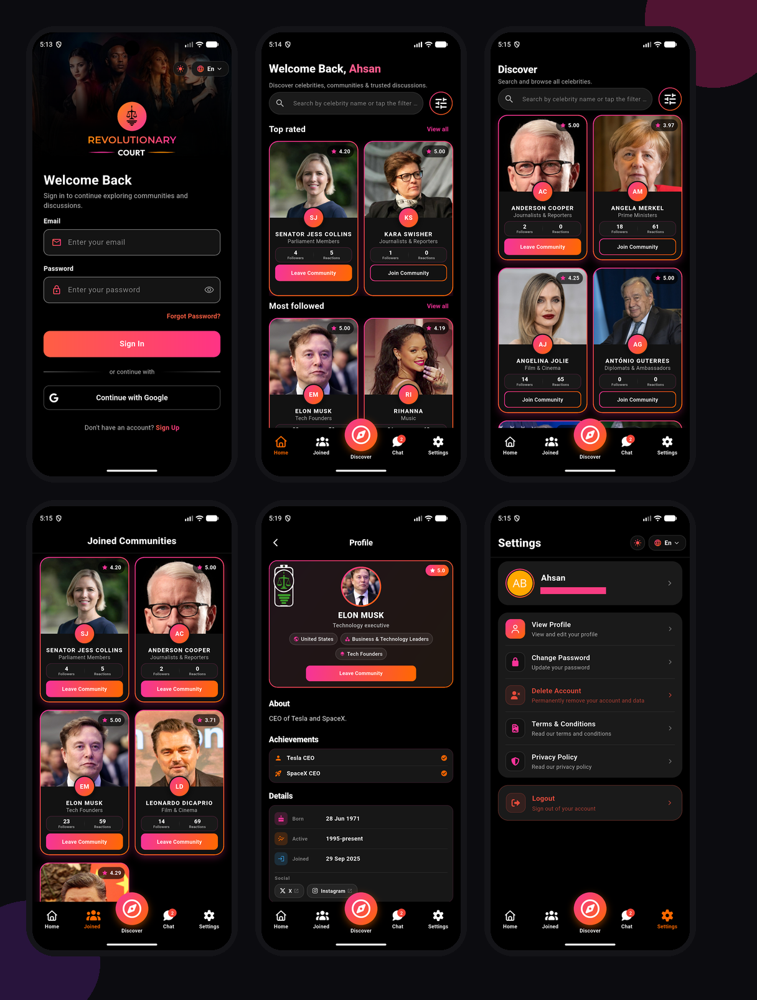
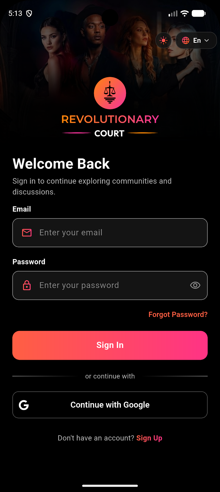
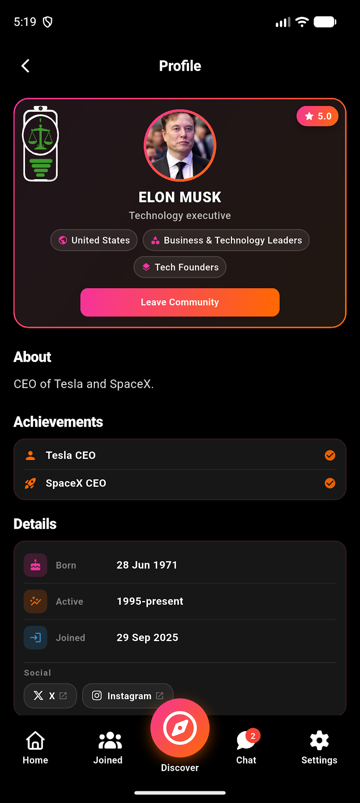
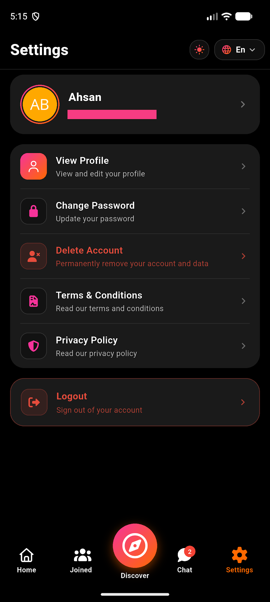
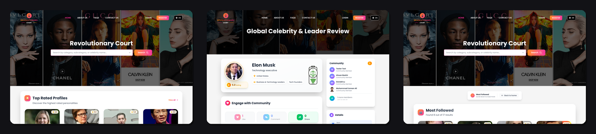
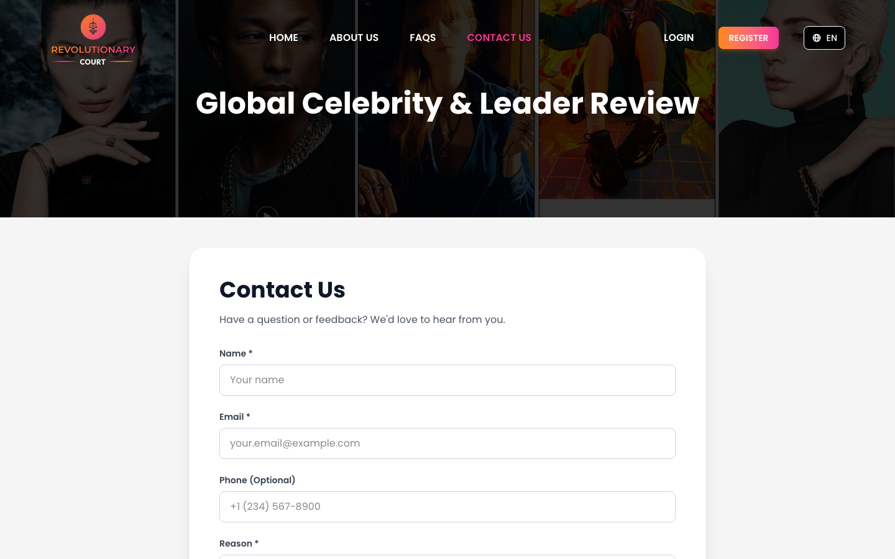
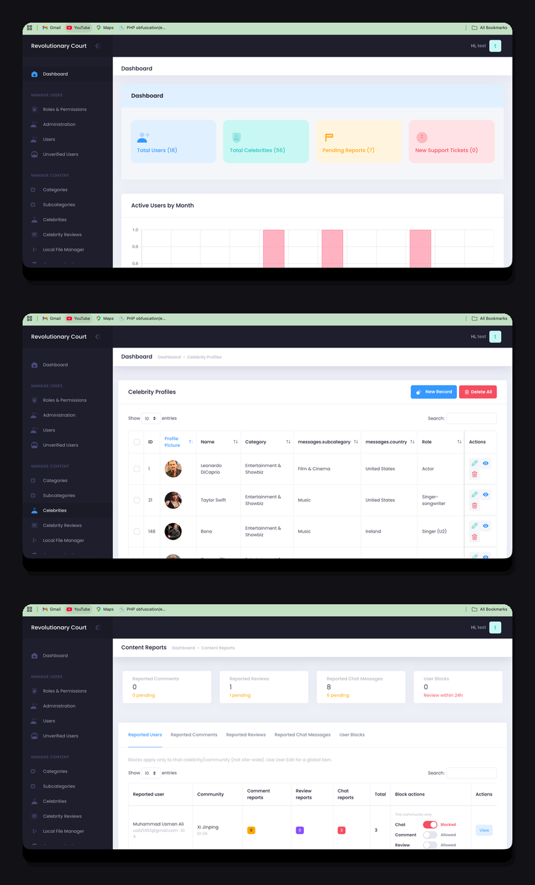

# Revolutionary Court — Case Study

Celebrity / public-figure **community platform** — ratings, reviews, communities, realtime chat, Flutter apps, a Next.js public site, and a Laravel admin for moderation.

> Portfolio case study: screenshots + architecture + stack. Application source is private.

---

## Public links

- Website: [revolutionarycourt.org](https://revolutionarycourt.org)
- Android: [Google Play — Revolutionary Court](https://play.google.com/store/apps/details?id=com.revolutionarycourt.app)

---

## Why this is useful

Fans need a focused place to discover personalities, join communities, rate/review, and chat — without general-social-network noise. Ops need tools to curate profiles and moderate reported content at community scope.

---

## Product surfaces

| Surface | Role |
|---------|------|
| **Flutter mobile app** | Primary UX — auth, discovery, communities, chat, reviews |
| **Next.js website** | Browser discovery — search, spotlights, profiles, i18n |
| **Laravel admin + API** | CMS, RBAC, celebrity catalog, reports, REST for apps |
| **Node Socket.IO chat** | Realtime messaging + live moderation push |

---

## Screenshots

### Mobile app

Framed Play Store captures — discovery, communities, join/leave, and chat entry points.

<p align="center">
  
</p>

<details>
<summary>Individual mobile screens</summary>
<p>





</p>
</details>

### Website

Home hero + celebrity profile + most-followed spotlight.

<p align="center">
  
</p>

<details>
<summary>More website pages</summary>

| Home | About | FAQ | Contact |
|------|-------|-----|---------|
|  |  |  |  |

</details>

### Admin panel

Dashboard metrics, celebrity CMS, and community-scoped content reports / moderation blocks.

<p align="center">
  
</p>

---

## Core features

### Discovery & communities
- Celebrity / public-figure profiles with categories & subcategories
- Spotlights: top-rated, most followed, most reacted, most viewed
- Join / leave communities; ratings & reviews
- Search by category, subcategory, or name

### Social & realtime
- In-app / web chat via **Socket.IO**
- Reactions, followers, unread counts
- Live moderation events when an admin blocks chat / comment / review for a community

### Auth & safety
- Email/password + **Google** + **Apple** Sign-In
- Content reports (comments, reviews, chat messages)
- Community-scoped Chat / Comment / Review blocks
- Multi-locale API (`en`, `es`, `ar`, `zh`, …)
- Privacy / delete-account flows for store compliance

### Admin / CMS
- Roles & permissions (RBAC)
- Users / unverified users
- Categories, celebrities, reviews, file manager
- Content reports queue with pending counts
- CMS pages, social links, authentication settings

---

## CI / CD

Production deploys run through **GitHub Actions** on push to `main` (plus manual `workflow_dispatch`).

| Pipeline | What it does |
|----------|----------------|
| **Backend (Laravel)** | Checkout → `rsync` app to server (exclude `.env`, `vendor`, `storage/uploads`) → remote `composer install` (PHP 8.2) → idempotent `artisan migrate` → caches / permissions |
| **Frontend (Next.js)** | Build + sync static/SSR app to web host → reload process |
| **Chat server (Node)** | Sync Socket.IO service → **PM2** restart so realtime moderation stays live |

Concurrency groups avoid overlapping deploys. Uploads / media dirs are excluded from destructive sync so user content is not wiped. Rating-image sync steps are allowed to continue-on-error so a media glitch does not block a code release.

Secrets stay in GitHub Actions (host, path, SSH credentials) — nothing sensitive is in this case-study repo.

---

## Tech stack

| Layer | Technology |
|-------|------------|
| Mobile | **Flutter** (Android / iOS) |
| Public web | **Next.js** (App Router) + **React** + **Tailwind CSS** |
| Admin UI | **Laravel** Blade + **Metronic** + DataTables |
| Backend API | **Laravel** REST (`/api/v1.0/{locale}/…`), Bearer / Sanctum-style auth |
| Realtime | **Node.js** + **Socket.IO** + **PM2** |
| Auth | Email/password, Google OAuth, Apple identity-token login |
| CI/CD | **GitHub Actions** → SSH/`rsync` → composer / migrate / PM2 |
| Infra | nginx / Ubuntu |
| i18n | Locale segment in API + web language switcher |

---

## Architecture

```
Flutter app  ──┐
               ├──► Laravel API  (/api/v1.0/{locale})
Next.js site ──┘         │
                         ├──► MySQL (users, celebrities, reviews, reports, …)
                         └──► Socket.IO chat server  ◄── realtime clients
Admin panel  ──────────► same Laravel app (session + Metronic UI)

GitHub Actions (main) ──► rsync / composer / migrate / PM2 per surface
```

---

## Notes

- Case study only — no application source or secrets in this repo.
- Internal admin / chat hostnames intentionally omitted from public links.
